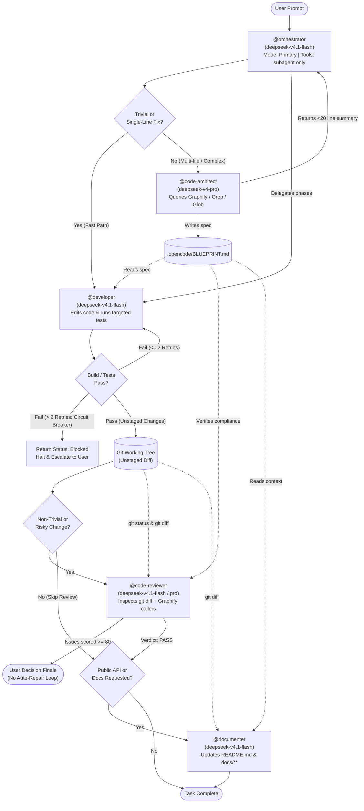
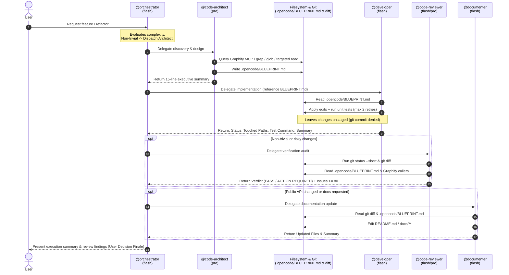

# OpenCode 5-Agent Cluster Architecture

Technical documentation for the local 5-agent engineering cluster configured in `~/.config/opencode/agents/`. This architecture prioritizes **token economy**, **strict permission sandboxing**, and **filesystem-based state hand-offs** over prompt-stuffing.

---

## 1. Directory Structure

```text
~/.config/opencode/agents/
├── orchestrator.md      # Primary coordinator (mode: primary)
├── code-architect.md    # Discovery & blueprint designer (mode: subagent)
├── developer.md         # Scoped implementation & testing worker (mode: subagent)
├── code-reviewer.md     # Static diff & blast-radius auditor (mode: subagent)
└── documenter.md        # Technical documentation updater (mode: subagent)
```

Transient workspace artifacts generated during execution:

```text
<project-root>/
└── .opencode/
    └── BLUEPRINT.md     # Ephemeral implementation spec written by @code-architect
```

---

## 2. System Topology & Control Flow

The cluster uses an **inverted model-tiering pattern**: a fast, low-cost model (`deepseek-v4.1-flash`) runs as the `orchestrator` router with zero direct file or shell access, delegating heavy reasoning exclusively to `code-architect` (`deepseek-v4-pro`) and execution to specialized `flash` subagents.



---

## 3. Sequence of Execution & State Hand-Off

Instead of relaying full file contents and long architectural plans back and forth through the `orchestrator` prompt context, agents communicate through **filesystem artifacts** (`.opencode/BLUEPRINT.md`) and **git state** (`git status` / `git diff`).



---

## 4. Agent Specifications & Permission Matrix

All agents enforce a **Default-Deny (`action: "*", effect: deny`)** baseline where applicable, whitelisting only the exact tools required for their role.

| Agent | Mode | Model | `read` | `grep` / `glob` | `edit` | `shell` (`bash`) | `mcp` (`graphify*`) | `subagent` |
| :--- | :--- | :--- | :---: | :---: | :---: | :---: | :---: | :---: |
| **`orchestrator`** | `primary` | `deepseek-v4.1-flash` | Deny | Deny | Deny | Deny | Deny | **Allow (`*`)** |
| **`code-architect`** | `subagent` | `deepseek-v4-pro` | **Allow** | **Allow** | `.opencode/BLUEPRINT.md` only | Deny | **Allow** | Deny |
| **`developer`** | `subagent` | `deepseek-v4.1-flash` | **Allow** | **Allow** | **Allow (`*`)** | **Allow** *(Deny `git commit/push/reset`)* | Deny | Deny |
| **`code-reviewer`** | `subagent` | `deepseek-v4.1-flash` *(or `pro`)* | **Allow** | **Allow** | Deny | `git status*`, `git diff*`, `git log*` only | **Allow** | Deny |
| **`documenter`** | `subagent` | `deepseek-v4.1-flash` | **Allow** | **Allow** | `docs/**`, `*README*`, `*.md` *(Deny `AGENTS.md`, `.opencode/**`)* | `git status*`, `git diff*` only | **Allow** | Deny |

---

## 5. Core Architectural Mechanisms

### 5.1 Context Isolation & Zero Prompt-Relay Tax
* **Child Session Isolation:** Each subagent runs in an isolated context window. If `@code-architect` or `@developer` inspects 15 files, those file contents stay inside the subagent's session and are discarded upon completion.
* **Artifact Hand-off (`.opencode/BLUEPRINT.md`):** `@code-architect` writes the detailed implementation blueprint directly to disk and returns a tiny summary to `@orchestrator`. `@orchestrator` instructs `@developer` to read `.opencode/BLUEPRINT.md`, typically reducing orchestrator output tokens by ~85%.

### 5.2 Working Tree Integrity (`git diff` Pipeline)
* `@developer` is explicitly blocked from running `git commit*`, `git push*`, and `git reset*` at the permission layer.
* All code modifications remain unstaged in the working tree so `@code-reviewer` and `@documenter` can inspect exact changes via `git status --short` and `git diff` without requiring `@orchestrator` to pass diffs in prompts.

### 5.3 Circuit Breakers & Anti-Looping Guards
* **Developer Retry Cap:** `@developer` is restricted to a maximum of **2 fix attempts** if a unit test or build fails. On the second failure, it halts immediately and returns `Execution Status: Blocked` with the error summary.
* **User Decision Finale:** `@orchestrator` never triggers an automatic repair loop between `@code-reviewer` and `@developer`. High-confidence review findings ($\ge 80$) are presented directly to the user to decide whether to apply fixes.

### 5.4 Graph-Guided Blast Radius (`graphify`)
* Both `@code-architect` and `@code-reviewer` prioritize querying `graphify` (`query_graph`, `get_neighbors`, `god_nodes`, `shortest_path`, or `graphify-out/`) over blind project-wide `grep` sweeps.
* During code review, if an exported signature changes, `@code-reviewer` inspects only the direct downstream callers identified by the dependency graph.

---

## 6. Agent Output Contracts

To prevent subagents from polluting `@orchestrator`'s context window with raw file dumps or test logs, each subagent enforces a strict return contract:

### `@code-architect` Output
* Writes full specification to `.opencode/BLUEPRINT.md` (Target Files, Data Flow, Phased Build Checklist, Verification Criteria).
* Returns an executive summary under 20 lines to `@orchestrator`.

### `@developer` Output
1. **Execution Status**: `Success` | `Failure` | `Blocked`
2. **Touched Paths**: List of modified or created file paths.
3. **Verification**: Exact test/build command executed and its pass/fail result.
4. **Summary of Changes**: Concise bullet points explaining the diff (no raw logs or full files).

### `@code-reviewer` Output
1. **Verdict**: `PASS` | `ACTION REQUIRED`
2. **Reviewed Scope**: List of modified (`M`) and untracked (`??`) files inspected.
3. **Findings**: Only issues with confidence $\ge 80$, grouped by `Critical [90-100]` and `Important [80-89]`, citing exact `path/to/file:line` and a 1–3 line fix recommendation.

### `@documenter` Output
1. **Updated Files**: List of documentation paths created or modified.
2. **Summary of Updates**: Bullet points describing sections added or revised (under 15 lines total).

---

## 7. Global Git Ignore Setup

Because `.opencode/BLUEPRINT.md` is a temporary session artifact used for inter-agent communication, exclude it globally so it does not appear as untracked noise in your repositories:

```bash
mkdir -p ~/.config/git
echo ".opencode/BLUEPRINT.md" >> ~/.config/git/ignore
git config --global core.excludesfile ~/.config/git/ignore
```
